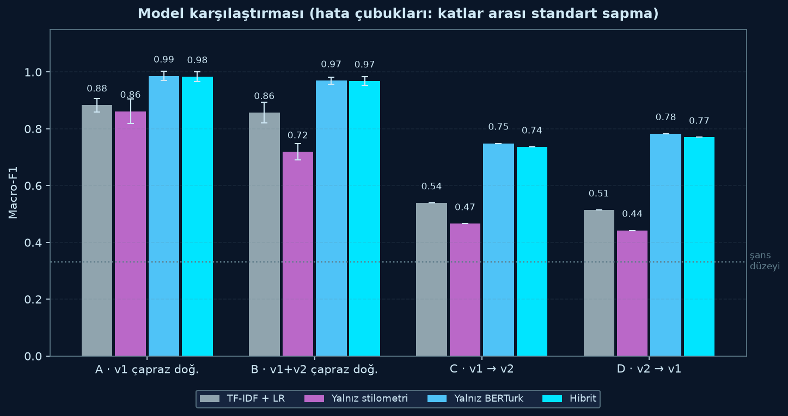

# Polar NLP

Kalıcı Türk bilim üssü personelinin seyir defteri kayıtlarındaki **yazım üslubunu** inceleyen bir karar destek
prototipi. Model her kaydı üç sınıftan birine atar:

| Sınıf | Kısaca |
|---|---|
| 0 · Objektif Rapor | Olay ve yapılan iş nötr biçimde aktarılıyor. |
| 1 · Bilişsel Yorgunluk | Yazar işin içinde ama yıpranmış: yük, gecikme, yakınma, zihinsel zorlanma. |
| 2 · Kış Sendromu | Yazar işten ve ortamdan kopmuş: görevi anlamsız bulma, bırakma, kayıtsızlık, çekilme. |

Model, Türkçe BERT (BERTurk) temsilini Türkçe ek örüntülerine dayanan 10 stilometrik göstergeyle birleştirir
(hibrit model). Streamlit paneli tekil ve toplu analiz, kişi bazlı risk seyri ve kelime düzeyinde açıklama sunar.

> **Önemli:** Veri sentetiktir ve sınıflar klinik tanı değildir. Bu bir araştırma prototipidir; gerçek personel
> verisiyle kullanılmadan önce etik onay, açık rıza, KVKK değerlendirmesi ve alan uzmanı doğrulaması gerekir.

## Sonuçlar

Bütün sayılar `results/metrics.json`'dan otomatik üretilir: **[docs/SONUCLAR.md](docs/SONUCLAR.md)**.
Yöntem ve sonuçların nasıl okunacağı: [docs/DENEYLER.md](docs/DENEYLER.md).

Öne çıkanlar (sayılar için SONUCLAR.md'ye bakın):

- Özgün veride (v1) skorlar çok yüksek, ama v1'de eğitilen modeller kalıp kelimeleri azaltılmış yeni veride (v2)
  belirgin biçimde düşüyor. Kelime sayan TF-IDF modeli en çok düşen model; v1'deki yüksek skorların önemli bir
  kısmı veri setine özgü kalıplardan geliyor.
- BERTurk tabanlı modeller kaynaklar arası genellemede açık ara en iyisi.
- Stilometri eklemek (hibrit) yalnız BERTurk'e göre doğruluğu artırmıyor; stilometrinin bu projedeki değeri
  **açıklanabilirlik** (panelde hangi göstergenin neden yüksek olduğunu göstermek).
- Karşılaştırmadaki BERT modelleri zaman kısıtı nedeniyle dondurulmuş gömmelerle eğitildi; ince ayarlı çapraz
  doğrulama bir sonraki adımdır ([YOL_HARITASI.md](docs/YOL_HARITASI.md), madde 0).



## Kurulum

```bash
python -m venv .venv
.venv\Scripts\activate                      # Linux/macOS: source .venv/bin/activate
pip install torch --index-url https://download.pytorch.org/whl/cpu   # GPU için pytorch.org'daki CUDA komutu
pip install -r requirements.txt
```

İlk çalıştırmada `dbmdz/bert-base-turkish-cased` (~450 MB) Hugging Face'ten indirilir.

## Kullanım

```bash
python scripts/egit_final.py      # paneldeki modeli eğitir (CPU'da ~15-30 dk) -> egitilmis_hybrid_model/
streamlit run dashboard.py        # paneli açar
```

Bütün sonuçları baştan üretmek için tek komut: `bash scripts/tum_hat.sh` (CPU'da ~20 dk). Adım adım:

```bash
python scripts/deney.py           # 4 model × 4 deney, çapraz doğrulama -> results/metrics.json
                                  # (varsayılan: dondurulmuş BERTurk; --ince-ayar ile her katta ince ayar, saatler sürer)
python scripts/egit_final.py
python scripts/gorseller.py       # results/*.png
python scripts/rapor.py           # docs/SONUCLAR.md
python -m pytest                  # tutarlılık ve birim testleri
```

Panelin toplu analiz sayfası `Metin` sütunlu bir CSV bekler; `Personel` ve `Tarih` sütunları da varsa kişi
bazlı seyir grafiği çizilir. Denemek için "Demo verisini kullan" düğmesi kurgusal 14 günlük günlükleri yükler.

## Proje yapısı

```
polar_nlp/     çekirdek paket: config, stilometri, veri, model, egitim, cikarim
scripts/       deney, egit_final, gorseller, rapor, veri_birlestir, veri_analiz, docx_to_csv
data/          polar_v1.csv (özgün 300), polar_v2.csv (600, ana veri), demo_gunlukler.csv, ham/ (üretim+denetim)
results/       metrics.json, demo_trend.json, grafikler
docs/          MIMARI, DENEYLER, SONUCLAR, VERI_KARTI, ETIKETLEME_KILAVUZU, YOL_HARITASI
tests/         pytest (internet ve GPU gerektirmez)
dashboard.py   Streamlit paneli
```

Ayrıntılı mimari: [docs/MIMARI.md](docs/MIMARI.md) · Veri: [docs/VERI_KARTI.md](docs/VERI_KARTI.md) ·
Sıradaki işler: [docs/YOL_HARITASI.md](docs/YOL_HARITASI.md) · Yapay zeka asistanları için: [CLAUDE.md](CLAUDE.md)

## Sınırlılıklar

- Eğitim ve test verisinin tamamı dil modelleriyle üretilmiş sentetik metinlerdir; etiket denetimi de dil
  modelleriyle yapılmıştır, insan denetimi yoktur.
- Veri küçüktür (600 metin) ve tek tohumla değerlendirilmiştir.
- Stilometrik göstergeler düzenli ifadelerle hesaplanır; biçimbilimsel çözümleme yapılmaz.
- "Risk skoru" sınıf olasılıklarının ağırlıklı toplamıdır; herhangi bir klinik ölçekle doğrulanmamıştır.
